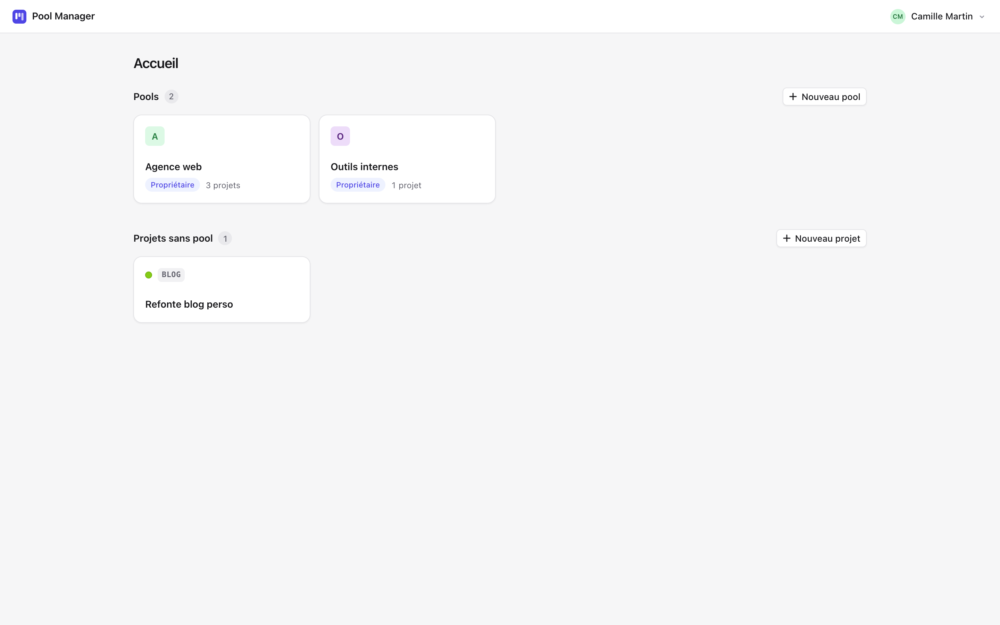
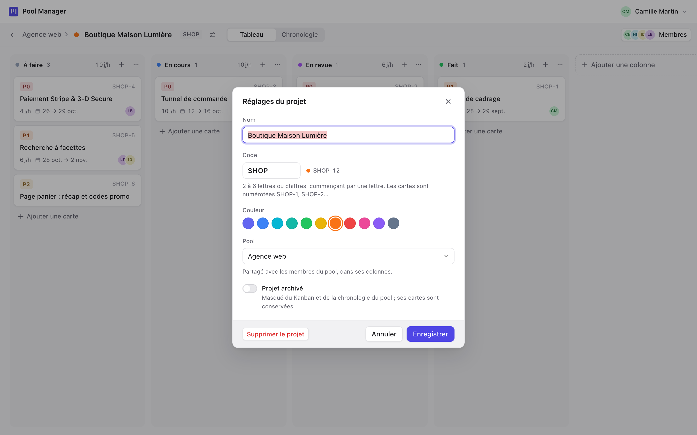
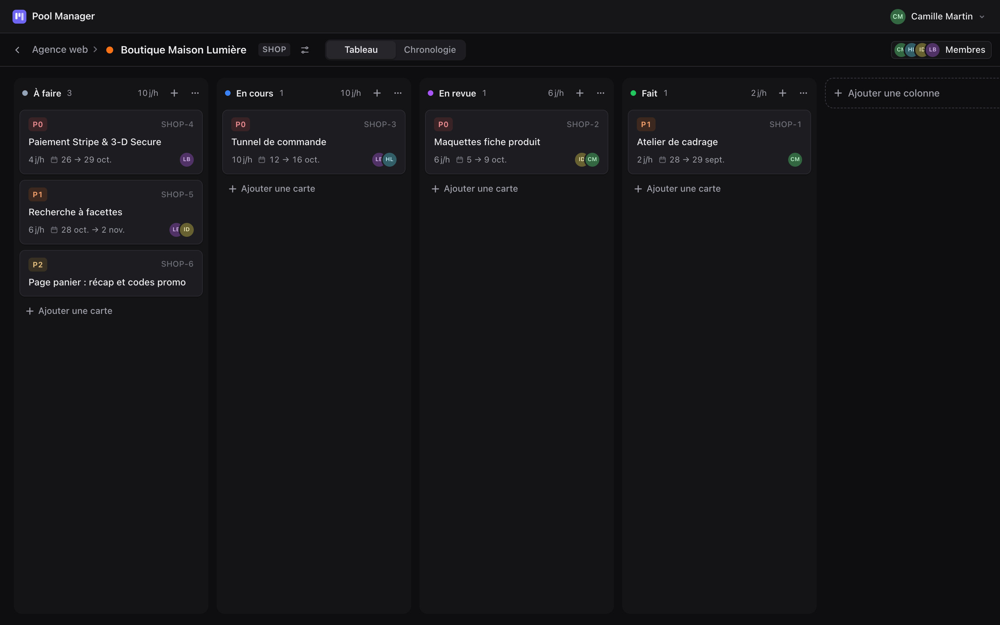

<div align="center">


# Pool Manager

**Pools de projets : Kanban et chronologie pour planifier le travail d'une petite équipe.**
Application desktop macOS & Linux — Tauri v2 · SvelteKit · Svelte 5.

[Fonctionnalités](#fonctionnalités) · [Installation](#installation) · [Développement](#développement) · [Serveur](https://github.com/OkilSaber/pool_manager_server)

</div>

<picture>
  <source media="(prefers-color-scheme: dark)" srcset="docs/screenshots/kanban-dark.png" />
  
</picture>

## Fonctionnalités

### Projets et pools

<picture>
  <source media="(prefers-color-scheme: dark)" srcset="docs/screenshots/home-dark.png" />
  
</picture>

- Un **projet** a un nom, une couleur et un **code court** : ses cartes sont numérotées `SHOP-12`, `VITR-3`…
  Il peut rester autonome (visible de vous seul, avec ses propres colonnes) ou être **rattaché à un pool**.
- Un **pool** rassemble plusieurs projets et une équipe : son tableau réunit les cartes de tous ses projets,
  avec un **filtre par projet** et ses propres colonnes.
- Chaque projet a aussi **son propre tableau** (Kanban + chronologie) avec ses seules cartes.
- Rattacher ou détacher un projet replace ses cartes dans les colonnes de même nom. Un projet peut être **archivé**.

<picture>
  <source media="(prefers-color-scheme: dark)" srcset="docs/screenshots/project-settings-dark.png" />
  
</picture>

### Kanban

Colonnes éditables et réordonnables, cartes en glisser-déposer. « Ajouter une carte » ouvre directement
la fiche de la carte, curseur dans le titre ; dans un pool, le projet est pré-rempli. Chaque colonne totalise
sa charge en jours/homme.

### Cartes

<picture>
  <source media="(prefers-color-scheme: dark)" srcset="docs/screenshots/card-dark.png" />
  
</picture>

- **Projet** (obligatoire) et référence `CODE-n`.
- **Priorité** P0 (critique) → P4 (minime), **chiffrage** en jours/homme, **date de début**.
- **Plusieurs assignés** avec une **répartition de la charge en %** (total = 100 %).
- **Fin prévue calculée** en jours ouvrés : la durée est celle de la plus grosse part
  (10 j/h à 50/50 → 5 jours ; 70/30 → 7 jours), week-ends sautés.
- Enregistrement automatique de chaque champ.

### Chronologie

<picture>
  <source media="(prefers-color-scheme: dark)" srcset="docs/screenshots/timeline-dark.png" />
  
</picture>

- Zoom **Jour / Semaine / Mois**, week-ends grisés, repère « Aujourd'hui ».
- Regroupement **par projet**, **par état**, **par assigné** (avec la charge de chacun) ou sans regroupement.
- **Glisser une barre** pour replanifier (aimantée au jour, Échap pour annuler), ou ←/→ au clavier.
- Les cartes sans date ou sans chiffrage sont listées à part, planifiables en un clic.

<picture>
  <source media="(prefers-color-scheme: dark)" srcset="docs/screenshots/timeline-assignees-dark.png" />
  
</picture>

### Équipe

Comptes par email ; le propriétaire d'un pool invite des membres par email et peut les retirer.
Les assignés d'une carte sont choisis parmi les membres du pool.

<table>
  <tr>
    <td></td>
    <td></td>
  </tr>
</table>

### Finitions

- Thème clair et sombre automatiques (suivent le système).
- Animations courtes et nettes, aucune animation sur les actions clavier, respect de « Réduire les animations ».
- Navigable au clavier, interface entièrement en français.

## Installation

Des paquets déjà construits sont disponibles dans les [Releases](https://github.com/OkilSaber/pool_manager_client/releases).
L'app macOS est signée ad hoc mais pas notariée par Apple : au premier lancement, ouvrez
**Réglages Système → Confidentialité et sécurité → Ouvrir quand même**, ou dans un terminal :
`xattr -dr com.apple.quarantine "/Applications/Pool Manager.app"`.

La version 0.2 du client nécessite le serveur **0.2** ou plus récent.

Le client a besoin d'un [serveur Pool Manager](https://github.com/OkilSaber/pool_manager_server) joignable
(sur votre machine ou le réseau local). Au premier lancement, renseignez son adresse dans
**Paramètres du serveur** (par défaut `http://localhost:8080`), puis créez un compte.

### Prérequis de compilation

- Rust stable, Node.js ≥ 20, `cargo install tauri-cli --version "^2"`
- Linux : dépendances WebKitGTK de Tauri, voir <https://v2.tauri.app/start/prerequisites/>
  (`libwebkit2gtk-4.1-dev`, `libayatana-appindicator3-dev`, `librsvg2-dev`, `build-essential`, `libssl-dev`)

### Construire les paquets

```bash
npm install
npm run tauri build
```

| OS    | Sortie (`src-tauri/target/release/bundle/`) |
| ----- | ------------------------------------------- |
| macOS | `macos/Pool Manager.app`, `dmg/*.dmg`       |
| Linux | `deb/*.deb`, `appimage/*.AppImage`          |

Chaque paquet se construit sur son OS cible.

## Développement

```bash
npm install
npm run tauri dev     # fenêtre native
npm run dev           # interface seule sur http://localhost:1420
npm run check         # Svelte + TypeScript
```

En navigateur, le serveur doit autoriser l'origine `http://localhost:1420` (c'est le cas par défaut).
Dans Tauri, les requêtes passent par `tauri-plugin-http` : pas de CORS ni de blocage « mixed content »
vers un serveur HTTP du réseau local.

### Structure

```
src/
├── app.css                 design tokens (couleurs, courbes, durées) et classes de base
├── lib/
│   ├── api.ts              client HTTP typé
│   ├── dates.ts            calculs en jours ouvrés (miroir du serveur)
│   ├── stores/             session, pool ou projet ouvert (mises à jour optimistes), toasts
│   ├── types/              types générés depuis le serveur — ne pas éditer
│   └── components/
│       ├── shell/          en-tête, menus, écrans d'authentification
│       ├── board/          page de tableau, Kanban, carte, assignés, membres
│       ├── projects/       création et réglages de projet, projets d'un pool
│       └── timeline/       chronologie (calculs de mise en page dans timeline.ts)
└── routes/                 login, signup, settings, pools, pools/[id], projects/[id]
src-tauri/                  coquille Rust Tauri v2
```

### Types partagés

`src/lib/types/` est généré par le serveur (`cargo test -p shared`, sortie dans `bindings/`).
Quand l'API change, recopiez-les depuis le dépôt serveur.

## Licence

Voir [LICENSE](LICENSE).
